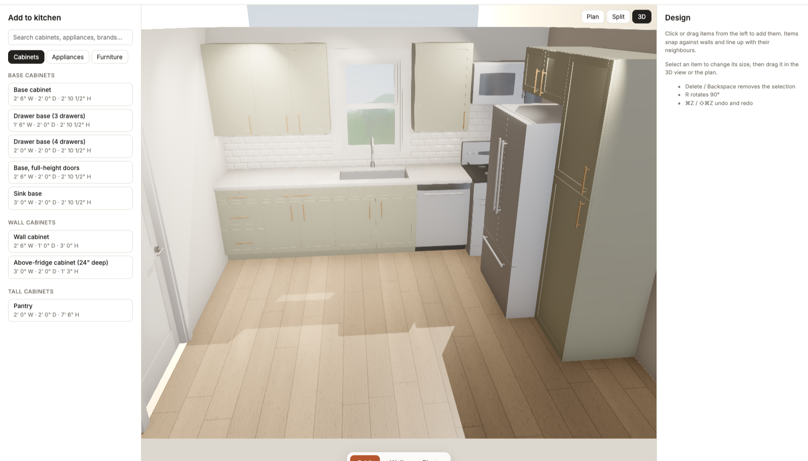

# Hearth

A browser-based kitchen planner, built to grow into whole-house design. Lay out the room, drop in cabinets and real appliances, pick finishes, then orbit, walk through, or path-trace a photo of the result.



## Features

- **Room:** rectangle or L-shape presets, drag corners and walls or type exact lengths, doors (single, double, pocket, barn; hinge and swing), windows (hung, casement, slider, picture, awning; grilles and frame colours), ceiling height, and a PNG/JPEG floorplan underlay with two-point scale.
- **Design:** cabinets in standard sizes (editable width, height, depth), Canadian-market appliances, and furniture. Click or drag to add. Items snap to walls and neighbours. Countertops, sinks and backsplash are generated over cabinet runs, with overhangs for islands.
- **Finishes:** painted (Benjamin Moore names) or wood cabinets in ten species and eleven stains, door style, framed or frameless, hardware, countertops, backsplash pattern and colour, flooring, wall paint, appliance finish. Sink style, sink finish and faucet are set per sink.
- **Views:** plan, 3D or split. Orbit, Walk (adjustable eye height, collides with walls and cabinets), and Photo (progressive path tracing).
- Undo/redo, imperial or metric, and autosave in the browser (IndexedDB).

## Running it

Requires Node 22+ and pnpm 9.

```bash
pnpm install
pnpm dev
```

Then open http://localhost:5280.

```bash
pnpm test        # core unit tests
pnpm typecheck   # all packages
```

## Layout

```
apps/web/            the app: steps, panels, plan editor, 3D viewport, store
packages/core/       units, geometry, document model, catalog, snapping (no React/Three)
packages/renderer/   React Three Fiber scene: room, cabinets, appliances, materials, lighting
```

See [PLAN.md](PLAN.md) for the roadmap and technical decisions.

## Notes

- Appliance dimensions are approximate. Confirm them against the manufacturer's installation guide before ordering cabinets.
- Paint swatches are on-screen approximations of the named chips.
